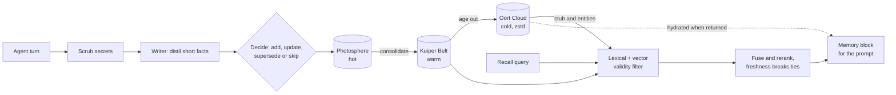

<p align="center">
  <a href="https://oortcloud.dev">
    <picture>
      <source media="(prefers-color-scheme: dark)" srcset="assets/brand/readme/hero-dark.svg" />
      <source media="(prefers-color-scheme: light)" srcset="assets/brand/readme/hero-light.svg" />
      
    </picture>
  </a>
</p>

<p align="center">
  <a href="LICENSE"></a>
  <a href="https://www.npmjs.com/package/oortmem"></a>
  <a href="https://oortcloud.dev"></a>
  
</p>

<p align="center">
  <b>Open-source memory for AI agents.</b><br />
  Old facts are closed out, not overwritten. Old history moves to cheap storage.<br />
  Every recall can explain why it was picked.
</p>

---

## Why Oort

Agents forget between sessions, and the usual fix is a vector store that only grows. That has two problems. Stale facts keep winning ("lives in Berlin" outranks "moved to Lisbon"), and the bill grows with every message you ever stored.

Oort keeps memory the way a solar system keeps matter:

| Tier | Name            | What lives there                                                       | Recall                           |
| ---- | --------------- | ---------------------------------------------------------------------- | -------------------------------- |
| Hot  | **Photosphere** | What just happened, and anything pinned                                | Instant, never searched for      |
| Warm | **Kuiper Belt** | Short distilled facts from past sessions, fully indexed                | A few milliseconds               |
| Cold | **Oort Cloud**  | Older history, zstd-compressed. The text stays, the heavy vector goes. | Comes back when it matters again |

When a fact changes, the old one is marked superseded and kept for history; a fact found wrong is marked corrected. Recall returns what is true now, unless you ask for `--as-of` a date, the `--history` of a fact, or what was `--known-at` a time (or just ask "what did we use in March").

## Quickstart

Install the CLI (Node 22.15 or newer), then connect your agent. `oort setup` detects your agents, asks how you want to provide keys, connects them and runs a quick check. Every step can be skipped.

```sh
npm install -g oortmem
```

```sh
oort setup
oort recall "where does the user live"
oort explain "where does the user live"   # each stage's rank and score
```

Every command and flag is in [docs/cli.md](docs/cli.md). To use Oort from your own code (`import { createOort } from 'oortmem'`), see [docs/sdk.md](docs/sdk.md). To build from source instead: `git clone https://github.com/oortmem/oort && cd oort && pnpm install && pnpm build && cd packages/cli && pnpm add -g .` (pnpm 12).

## Works with

Claude Code (hooks, plus the MCP server), Claude Desktop, Codex, Cursor, Gemini CLI, VS Code, and any MCP client over stdio. `oort connect <host>` writes the config, backs up the old file and prints the diff. [Claude Code guide](docs/claude-code.md).

## How it works



- **Write path.** Every turn is scrubbed of secrets first. A small writer model distils it into short facts, and a decision model compares each fact with what is already stored: add it, update it, supersede the old one, or skip it.
- **Read path.** Keyword (SQLite FTS5) and vector (sqlite-vec) search run together. Facts that are no longer valid are filtered out before ranking. Results are fused, reranked when it helps, and freshness only breaks ties, so a newer fact never beats a better match.
- **Local first.** Everything lives in `~/.oort` on your machine, in one SQLite file plus compressed cold blobs. Nothing is hosted unless you choose Oort Cloud. With no API keys and no Oort Pro login, the local commands make no network call at all (recall falls back to keyword search), and a test runs them with every socket blocked.

## Packages

| Package                                            | What it does                                                                                                                                      |
| -------------------------------------------------- | ------------------------------------------------------------------------------------------------------------------------------------------------- |
| [`oortmem`](packages/cli)                          | The `oort` command line (setup, connectors, the local MCP server, recall, import and export), and the TypeScript SDK ([docs/sdk.md](docs/sdk.md)) |
| [`@oortmem/core`](packages/core)                   | The engine: secret scrubbing, the write gate, hybrid recall, fusion, tiering and project scope                                                    |
| [`@oortmem/store-sqlite`](packages/store-sqlite)   | Storage on SQLite with FTS5 and sqlite-vec, and zstd cold blobs                                                                                   |
| [`@oortmem/writer`](packages/writer)               | Turns conversation turns into short, self-contained facts                                                                                         |
| [`@oortmem/decide-jev`](packages/decide-jev)       | Add, update, supersede or skip decisions, using TypeSafe Jev                                                                                      |
| [`@oortmem/embed-voyage`](packages/embed-voyage)   | Embeddings through Voyage AI                                                                                                                      |
| [`@oortmem/rerank-voyage`](packages/rerank-voyage) | Reranking through Voyage AI                                                                                                                       |
| [`@oortmem/local-models`](packages/local-models)   | Embeddings and reranking on your CPU (ONNX Runtime): no keys, no account                                                                          |
| [`@oortmem/claude-code`](packages/claude-code)     | Claude Code hooks and transcript import                                                                                                           |
| [`@oortmem/mcp`](packages/mcp)                     | The MCP tools, schemas, instructions and skill, served over any memory backend                                                                    |
| [`oortmem` on PyPI](python)                        | A Python launcher for the same `oort` command (still needs Node 22.15 or newer)                                                                   |

Install bundles for Claude Desktop, Claude Code, Codex, Cursor and Gemini CLI are in
[`distribution/`](distribution).

This repo is the open-source engine and CLI only. The hosted side (oortcloud.dev, Oort Cloud and the Oort Pro relay) is a separate service; the engine and CLI reach it only over HTTPS when you use Oort Pro.

## Keys, or Oort Pro

Oort calls three model services: Voyage AI (embeddings and rerank), TypeSafe (decisions) and Anthropic (the writer). Bring your own keys with `oort keys set`. They stay in the macOS Keychain, or in a `0600` credentials file on Linux and Windows.

Or run with **no keys and no account**: `npm i -g @oortmem/local-models && oort models pull` downloads small embedding and rerank models (58 MB, MIT and Apache-2.0) and runs them on your CPU, offline. Saving new memories still needs the decision and writer models. [Local models](docs/cli.md#no-api-keys-local-models).

Or use **Oort Pro**: $19/month, VAT included where applicable. No API keys needed. Run `oort login`, then `oort cloud use` to keep your memories in Oort Cloud in the EU, with a dashboard, a star map and a connector for claude.ai and ChatGPT. You can export or delete them at any time, or keep them on your machine and use only the relay, which stores no content. [Pricing](https://oortcloud.dev/pricing).

## Projects and trust

Memories are scoped to a project. By default its id comes from the main repository root, so a git worktree shares memories with its main checkout. A `project.id` in a repo's `oort.config.json` is ignored until you run `oort project link`, because a cloned repo could otherwise use it to read another project's memories. Details in [docs/cli.md](docs/cli.md#projects-oort-project).

## Develop

```sh
pnpm install
pnpm verify   # public-repo and copy checks, format, lint, build, typecheck and every test
```

The export format is documented in [docs/export-format.md](docs/export-format.md).

## Security

Please report vulnerabilities to **security@oortcloud.dev**, not in a public issue.

## License

[Apache 2.0](LICENSE). Made in Gothenburg, Sweden.
